

  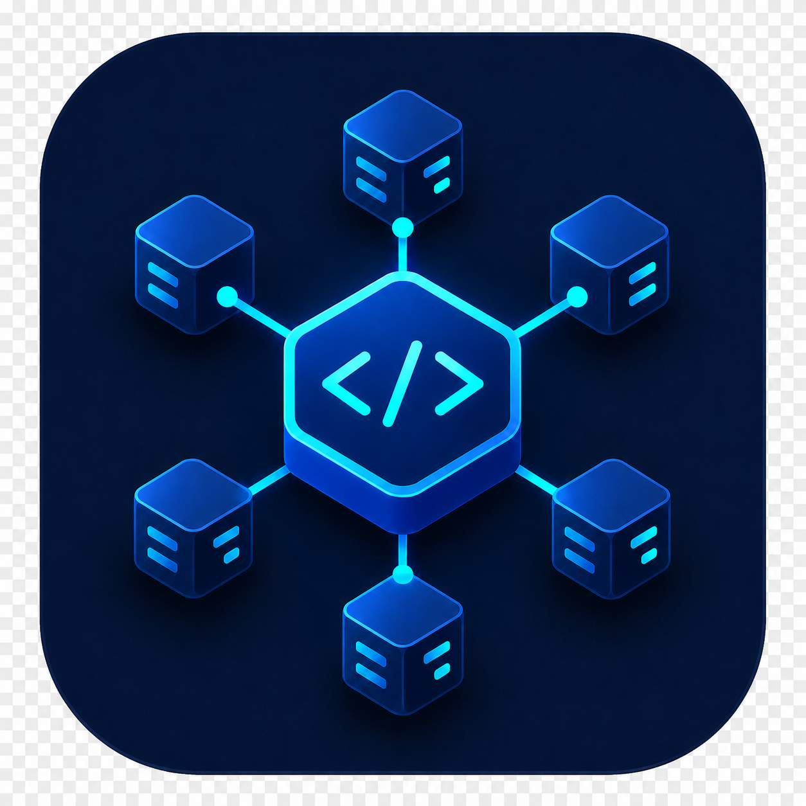

  <h1>CodexHub</h1>

  
<strong>A desktop control console for Codex App SSH workspaces on Windows, macOS, and Linux.</strong>

  
Prepare Linux hosts, install or update remote Codex, apply profiles, sync skills, and inspect redacted task logs without writing to Codex App private state.

  

    <a href="docs/zh-CN/README.md">简体中文</a>
    ·
    <a href="#-install">Install</a>
    ·
    <a href="docs/macos-support.md">macOS</a>
    ·
    <a href="docs/linux-support.md">Linux</a>
    ·
    <a href="docs/known-limitations.md">Known Limitations</a>
    ·
    <a href="SECURITY.md">Security</a>
  

  

    
    
    
    
    
    
  

## 🧭 At a Glance

CodexHub is a desktop control console for one practical workflow: prepare a Windows, macOS, or Linux workstation to use Codex App across SSH-connected Linux hosts.

* Manage local OpenSSH key state and CodexHub-owned SSH aliases.
* Bootstrap new Linux hosts with a one-time password, then switch to key login.
* Probe remote Codex, config, shell, PATH, and skill state before changing anything.
* Preview and apply Codex profiles and skills with explicit confirmations and redacted logs.
* Open local or SSH terminals, browse local/SFTP files, use linked split panes, and track resumable transfers from one Workspace.
* Hand the verified SSH alias back to Codex App through `Settings > Codex > Connections`.

## 🖼️ Screenshots

| View | Windows | macOS |
| --- | --- | --- |
| **Dashboard** Review every managed host at a glance, including SSH reachability, remote Codex status, profile alignment, skill inventory, and recent task results. | 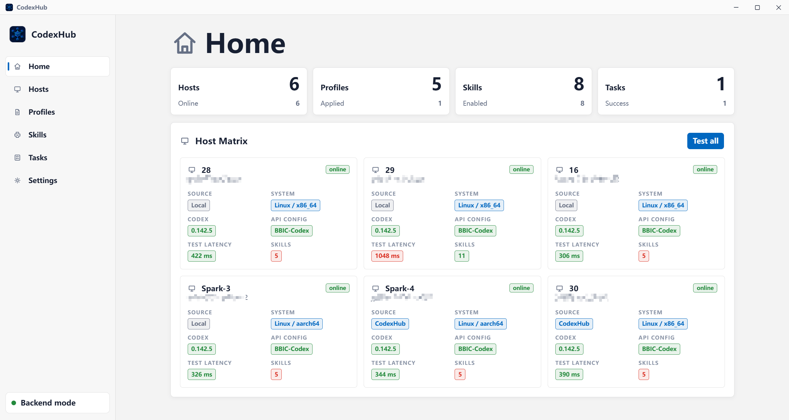 | 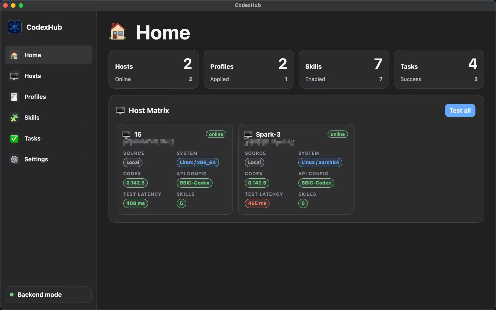 |
| **Monitor** Watch memory, aggregate storage, CPU, and GPU snapshots in a two-row summary with usage percentages, then expand GPU users into process details. | 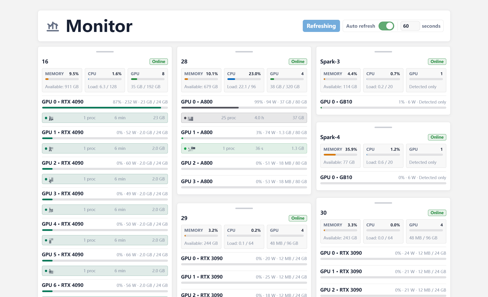 | 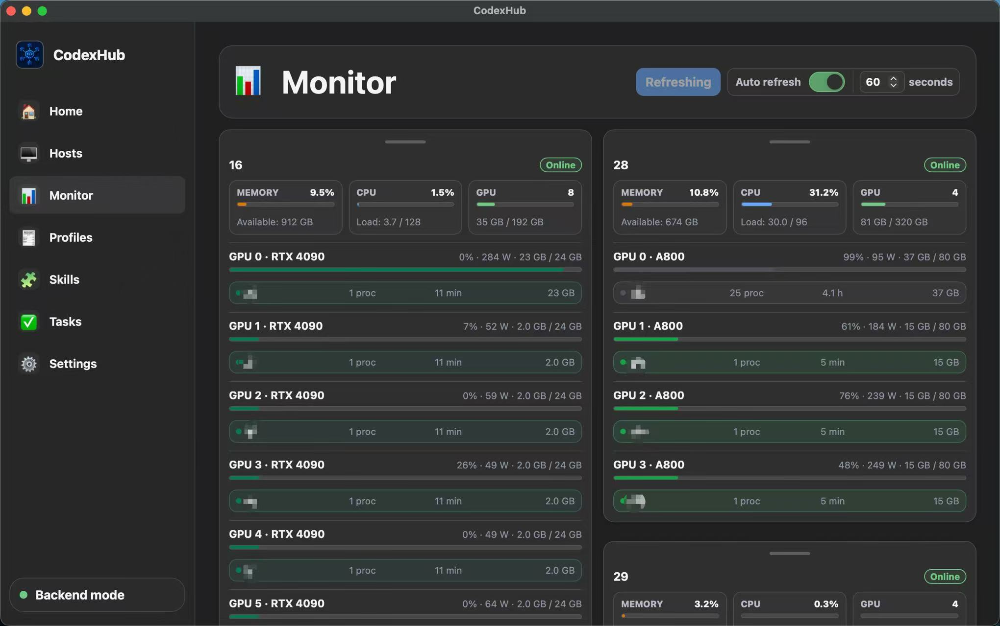 |
| **Hosts** Add or inspect SSH hosts with guided key setup, one-time password bootstrap, connection tests, and remote Codex probes. | 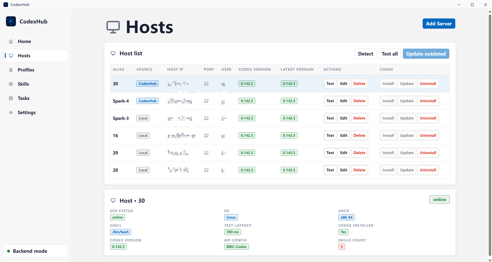 | 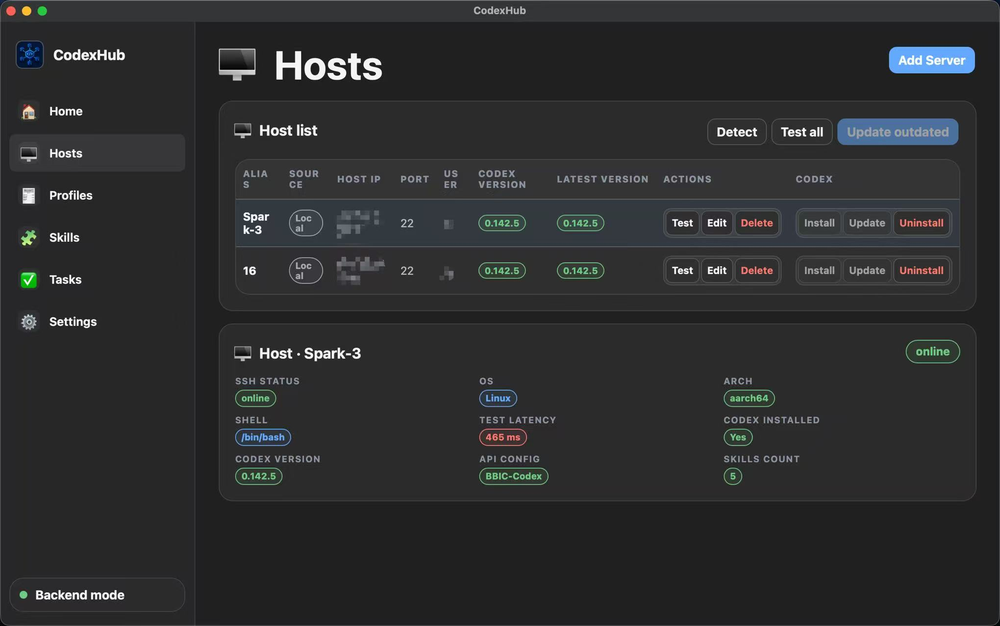 |
| **API & Profiles** Keep local API configuration names and profile templates organized before previewing or applying remote config changes. | 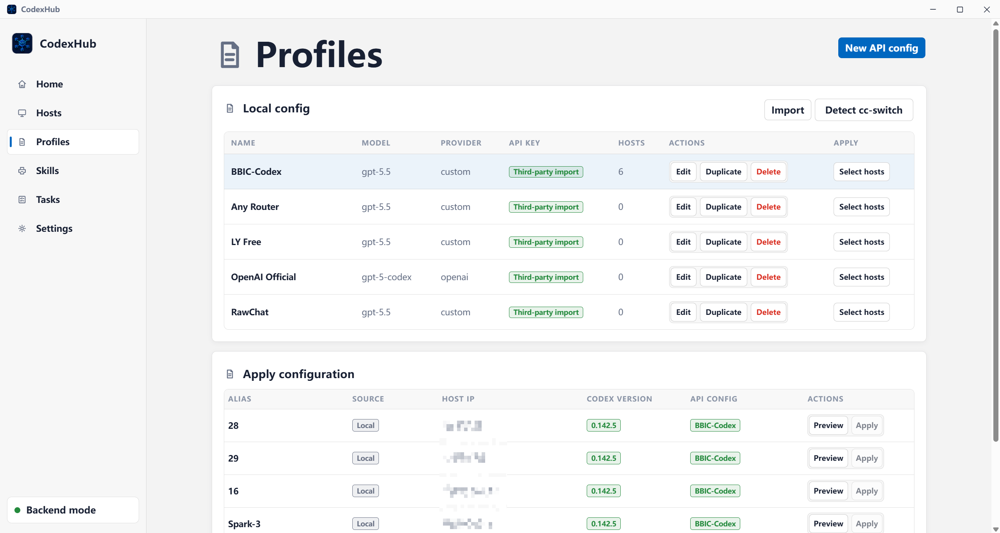 | 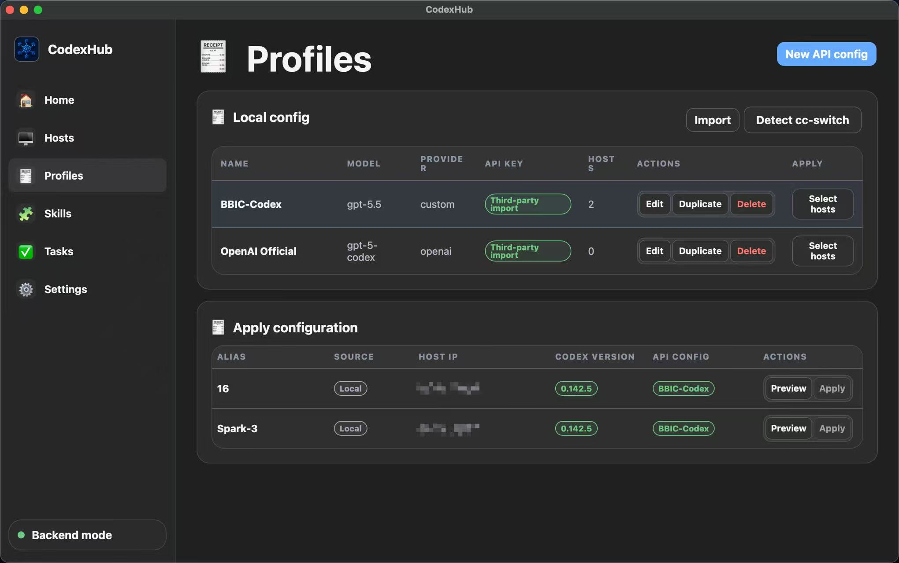 |
| **Skills** Import local or GitHub skill packs, check target inventories, preview installed skill tags, and download or remove skills with task-log evidence. | 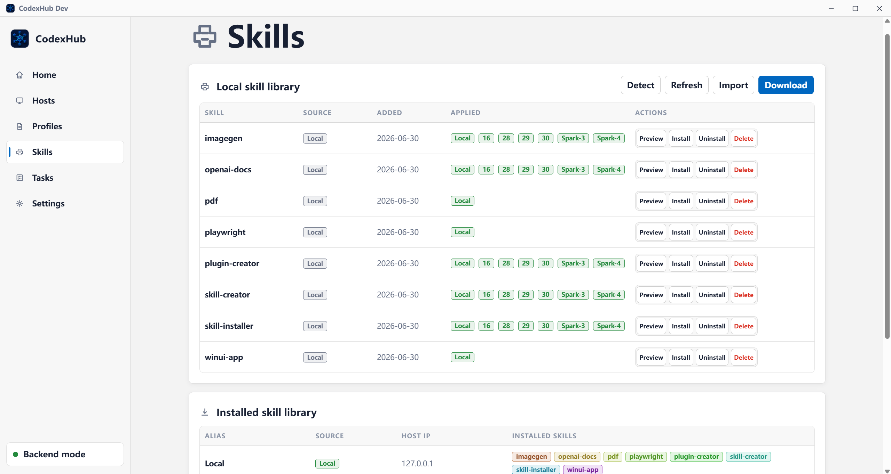 | 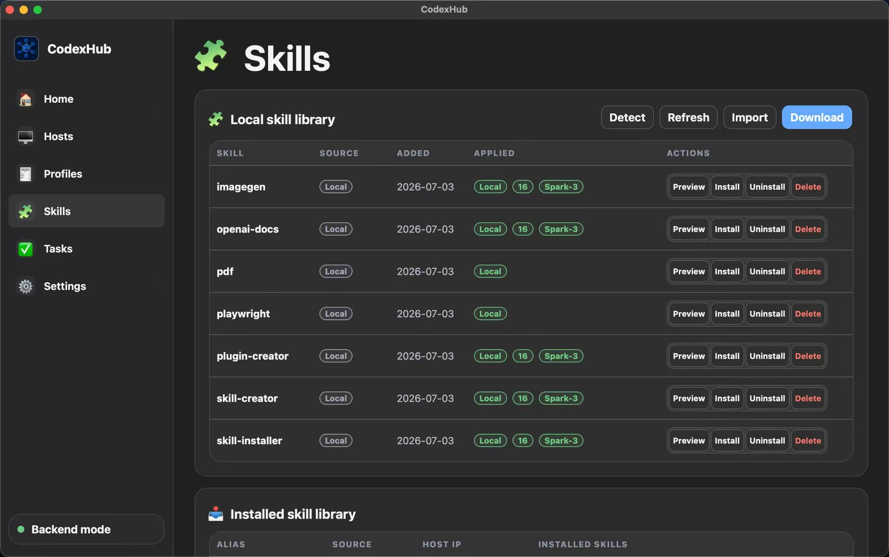 |
| **Settings** Check local SSH readiness, manage app update checks, and review platform-specific runtime preferences. | 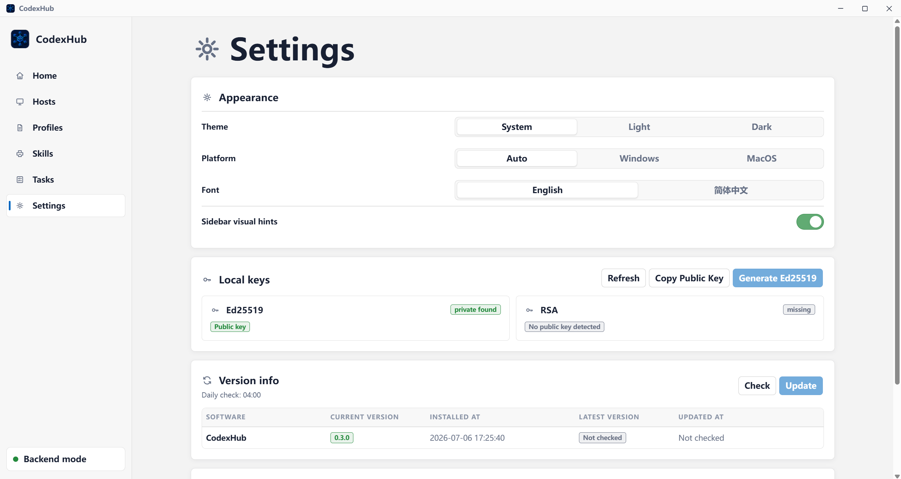 | 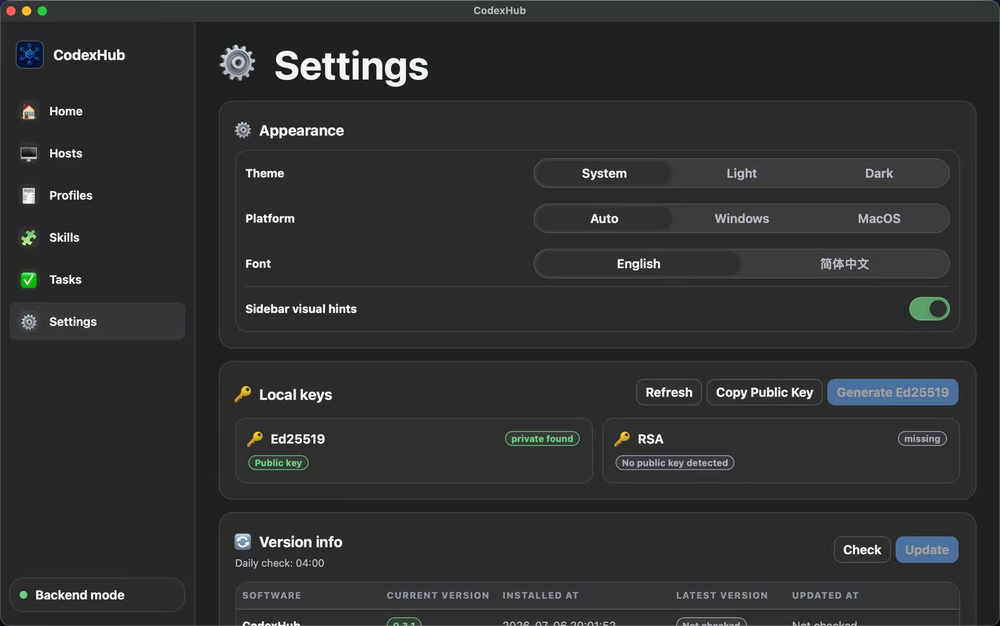 |

## ✨ Core Features

* Reads local OpenSSH status and public keys on Windows, macOS, and Linux.
* Uses a platform adapter for local SSH and Codex paths on Windows, macOS, and Linux.
* Generates a non-overwriting Ed25519 key when no suitable key exists.
* Imports safe aliases from the local SSH config in read-only mode (`%USERPROFILE%\.ssh\config` on Windows, `~/.ssh/config` on macOS/Linux).
* Adds, updates, or deletes only CodexHub-managed SSH config blocks with timestamped backups.
* Tests SSH with `ssh <HostAlias> echo ok`.
* Probes Linux remotes for OS, architecture, shell, PATH, Codex CLI, command availability, `~/.codex/config.toml`, API env readiness, and skill counts.
* Installs or updates the real remote `codex` command in the remote user's home directory.
* Manages local profile templates and applies rendered TOML to remote `~/.codex/config.toml`.
* After a confirmed profile apply, can gracefully reload strictly matched Codex processes owned by the current remote SSH user; the recommended mode preserves interactive CLI and exec sessions.
* Imports local or GitHub skill directories containing `SKILL.md`.
* Shows read-only, page-active memory, storage, CPU, and GPU resource snapshots for remembered hosts. Storage aggregates mounted local disk filesystems into available / total capacity with a distinct usage bar; GPU users expand into process details.
* Edit the Monitor refresh interval directly and set a per-host sample timeout from 1 to 60 seconds, defaulting to 30 seconds. Both settings are saved after editing and the toolbar adapts to narrow windows.
* Runs local and SSH terminal tabs with reconnect, resize, search, configurable scrollback, screen-reader mode, and large-paste confirmation.
* Browses local and remote SFTP files with pagination, search, preview, creation, rename/copy, and recoverable destructive operations.
* Tracks uploads and downloads with pause, retry, cancel, conflict handling, retained recovery cards, and explicit reauthorization after restart.
* Verifies remote uploads, downloads, and resume prefixes with server-side SHA-256, returning only the digest and avoiding a second file transfer for verification.
* Links Terminal and Files through split panes so the selected host and working directory can move together.
* Persists the latest 100 redacted task records across restarts and keeps each retained task's complete diagnostics available on the Tasks page.
* Keeps dialogs keyboard-contained with Escape close, trigger-focus restoration, scoped live announcements, and reduced-motion support.
* Keeps a Windows tray / macOS menu bar / Linux tray status icon. The first window close asks whether future closes exit CodexHub or minimize it to the tray, and the choice can be changed later in Settings.
* Guides the user to Codex App after CodexHub verifies an SSH alias.

## 🔐 Safety Boundaries

CodexHub is designed to be conservative by default:

* It never stores SSH private keys, passphrases, one-time passwords, or OpenAI API keys in plaintext app files.
* One-time passwords and stored API keys can be revealed only by an explicit user action for verification or copying; they remain transient in the UI and are never written to browser storage or task logs.
* SSH setup and key-status flows return and copy public key text only; they do not open or display private-key contents.
* Workspace Files is an explicit user-operated local file tool. It can browse, preview, copy, and transfer any file the current OS user can access, including sensitive files the user deliberately selects.
* It does not edit unmanaged SSH config blocks.
* It writes only marked blocks between `# >>> CodexHub managed host: <alias>` and `# <<< CodexHub managed host: <alias>`.
* It does not write Codex App private files, databases, sockets, caches, or undocumented state.
* Remote process reload uses SSH plus Linux `/proc` identity checks and `SIGTERM` only. It never uses broad `pkill`/`killall` matching and never controls the local ChatGPT/Codex App process.
* Install/Profile cleanup only removes strictly marked old runtimes; a verified Update may stage strictly older releases in a retained backup. Current, targeted, active, changed, or ambiguous Codex identities are always preserved.
* Remote Codex config uses `env_key` / `apiKeyEnvVar`. When you explicitly apply a profile with a stored key, CodexHub writes that key only to the selected host's `~/.codex-hub/env` file with restrictive permissions; remote config, metadata, and task logs stay key-free.
* Mutating remote operations use previews or explicit confirmations, scoped writes/deletes, and task-log evidence; config writes create backups when content changes.

More detail: [Security policy](SECURITY.md) and [known limitations](docs/known-limitations.md).

## ✅ Requirements

For the Windows desktop app:

1. Windows 10/11.
2. Microsoft WebView2 Runtime.
3. Windows OpenSSH client: `ssh.exe`, `scp.exe`, and `ssh-keygen.exe`.
4. SSH access to Linux remote hosts where Codex App will run.

For the macOS desktop app:

1. An Apple Silicon Mac for the public `.dmg`; use a real Mac again when validating a new local `.app` / `.dmg` build.
2. OpenSSH client tools and `ssh-keygen`.
3. Codex CLI installed through official OpenAI/Codex guidance.
4. SSH access to Linux remote hosts where Codex App will run.

For the Linux desktop app:

1. Ubuntu/Debian x86_64 or arm64.
2. OpenSSH client tools and `ssh-keygen`.
3. Codex CLI installed through official OpenAI/Codex guidance.
4. SSH access to Linux remote hosts where Codex App will run.

## 🚀 Install

For everyday use, download the latest stable build from this repository's Releases page.

* Windows: download and run `CodexHub_0.5.6_x64-setup.exe`; signed stable installers can check and install future Windows updates from Settings.
* macOS Apple Silicon: download `CodexHub_0.5.6_aarch64.dmg`, open it, and move `CodexHub.app` to Applications. The v0.5.6 macOS artifact is unsigned/ad-hoc, so macOS may require Control-click > Open or Privacy & Security approval the first time. Only trust files downloaded from this repository's Release page.
* The `.app.tar.gz` asset is for the in-app updater. macOS users should install from the `.dmg`, not by manually extracting the updater archive.
* Linux Ubuntu/Debian x86_64: install `CodexHub_0.5.6_amd64.deb`. Linux uses the macOS-style appearance by default and can be switched in Settings. Validated Linux stable builds participate in the signed updater feed.
* Linux Ubuntu/Debian arm64: install `CodexHub_0.5.6_arm64.deb`. Validated Linux stable builds participate in the signed updater feed.
* If Settings update checks fail, CodexHub opens a log dialog and records the run in Tasks for later review.

## ⚡ Quick Start

1. Open CodexHub.
2. In Settings, check Local SSH.
3. Generate an Ed25519 key only if one does not already exist.
4. Add a server with host, user, port, and identity file.
5. Use one-time password setup when the remote does not already accept your key.
6. Test the SSH alias and probe the remote host.
7. Select the verified alias in Terminal, then open Files or Split to work in the same host and directory context.
8. Upload or download files and monitor conflicts, pause/retry/cancel actions, and recovery state in Transfers.
9. Install or update remote Codex.
10. Create a profile, preview it, then apply it to the host.
11. Import a skill and install it to local or remote targets.
12. Open Tasks to inspect redacted logs.
13. In Codex App, go to `Settings > Codex > Connections` and add or enable the verified SSH alias.

## 📘 Guided Workflows

### Add a Host

* Use Hosts > Add Server for a new CodexHub-managed alias.
* Existing aliases can be imported from local SSH config without rewriting unmanaged blocks.
* New managed hosts are written only after password login, public-key install, permission repair, and key-login verification succeed.
* First-time host keys use OpenSSH `StrictHostKeyChecking=accept-new`; changed host keys still fail.

### Install or Update Codex

* Use Profiles or Dashboard actions to run `check-version`, `install`, or `update`.
* The remote command remains `codex`; profile apply may install a CodexHub-managed `~/.local/bin/codex` launcher that sources `~/.codex-hub/env` and then execs the real Codex binary.
* Installs target `$HOME/.local/bin` and `$HOME/.codex`.
* PATH repair checks `.bashrc` or `.zshrc`, `.profile`, and existing `.bash_profile` / `.zprofile`, and adds an idempotent CodexHub-managed block only when no existing `$HOME/.local/bin` entry is present.
* Single-host and batch Update first inspect current-user processes that reference managed standalone releases. CodexHub classifies confirmed Codex App services, SSH proxies, and CLI/sessions without returning raw argv, then asks for explicit approval. On an approved host, it revalidates exact identities, sends `SIGTERM`, and escalates stubborn or safely classified restarted processes to exact-PID `SIGKILL` until two consecutive scans are clear. Unknown, unselected, other-user, outside-approved-release, or unverifiable processes still fail before PATH repair or installation.
* When an eligible local loopback proxy is available, each concurrent host opens its own temporary SSH reverse tunnel to that shared proxy and tries the official installer through it first. Direct access, mirrors, and local upload remain fallbacks, and no proxy setting is persisted remotely.
* After a successful install or update method, CodexHub keeps a verified standalone target on the canonical executable selected through `~/.codex/packages/standalone/current`: `bin/codex` for local and current official package releases, including the official package's exact `codex -> bin/codex` compatibility link, or `codex` for the legacy official layout. It verifies that the target, managed launcher, and login-shell `codex` command report the same version. Each writer takes a current-user PID/starttime lock, re-reads the runtime after locking, and rejects both the candidate and post-write state below the highest verified version floor.
* After final verification, Install and Profile apply remove only obsolete, strictly marked managed releases. Update additionally adopts every direct `releases/<entry>` version that has one canonical executable layout, matches its binary-reported version, and is strictly older than the newly verified version. The exact official `codex -> bin/codex` compatibility link counts as the same canonical package layout; independent or noncanonical second paths remain ambiguous. Each eligible release, launcher capture, and known residual launcher/helper link is moved into `~/.codex-hub/deletion-backups/update-<UTC>-<PID>/`. The task result reports the safe backup ID; the backup is retained for manual inspection, so disk space is not reclaimed until that backup is explicitly deleted. Current, targeted, same/newer, invalid-marker, raced, active, or otherwise uncertain releases stay in place. All cleanup shares the runtime writer lock, rechecks current-UID processes, requires a same-filesystem no-replace move, and never overwrites an existing backup. Only this reversible staged-Update path may tolerate an unreadable `/proc/<pid>/exe` for a stable, double-read current-user `sshd`, `(sd-pam)`, `sftp-server`, or `fusermount3` session helper; an exact `/usr/lib/systemd/systemd --user` or `/lib/systemd/systemd --user` process with no extra argument; or a zombie with state `Z`, an empty command line, `Threads: 1`, and only its leader TID. PID/starttime/state/comm/full-command-line identity and the zombie task proof where applicable must remain stable at every candidate check, and the task summary reports the ignored process count. Install/Profile cleanup remains strict, while any new, changed, unknown, multi-thread zombie, or Codex-like process still defers cleanup.

### Use Workspace Terminal, Files, Split, and Transfers

* Terminal opens local shells or existing SSH aliases in tabs. Disconnects stay visible and can be reconnected; resize, search, scrollback, screen-reader mode, and large-paste confirmation are available from the workspace and Settings.
* Files browses the local machine or the selected host over SFTP. Directory paging and search are explicit; preview, create, rename, copy, overwrite, and delete actions use the current location and confirmation rules.
* Delete, overwrite, and rename recovery records can be restored from Files or Transfers. A permanent purge remains a separate confirmed action.
* Transfers tracks upload/download progress, pause, retry, cancel, and conflict choices. After an app restart, local file access grants must be explicitly reauthorized before affected queued work can continue.
* Split keeps Terminal and Files visible together and can synchronize the active terminal working directory with the file browser when the backend reports a canonical path.

### Apply a Profile

* Profiles render to TOML.
* API keys are configured as environment variable references. If the profile has a stored local key, applying it writes the real value to the selected host's `~/.codex-hub/env`, adds shell source blocks with backups, and checks that the env var is available.
* Preview before applying.
* If the remote config already matches, CodexHub reports no changes and does not create a backup.
* If the file changes, CodexHub creates a timestamped backup and records the result in Tasks.
* Runtime reconciliation prevents profile apply from restoring a stale standalone release: the managed target continues to follow `standalone/current`, and a lower runtime version is rejected.
* Every apply asks whether to reload only remote Codex App services (recommended), leave processes running, or stop all confirmed remote Codex sessions. Stopping all sessions requires an extra acknowledgement.
* If no replacement App service appears within 15 seconds, the saved configuration remains active and CodexHub directs you to the local ChatGPT/Codex App at `Settings > Codex > Connections` for a manual reconnect.

### Install Skills

* Import a local folder with `SKILL.md`, or import a GitHub repository/subdirectory URL.
* CodexHub stores a managed local copy in the app config directory.
* Target checks use cached inventory, so run detection before installing to a new host.
* Installed skill tags can be previewed. Download imports that installed directory into the local skill library; uninstall requires confirmation and permanently removes only the current target's skill directory.

## ⚠️ Known Limitations

* The v0.5.6 macOS artifact remains unsigned/ad-hoc; Developer ID signing and notarization are not configured yet.
* Linux desktop packages target Ubuntu/Debian x86_64 and arm64 `.deb` first; rpm, AppImage, Snap, and Flatpak are not in scope for v0.5.6.
* CodexHub does not automatically register SSH hosts inside Codex App.
* CodexHub can reload the current SSH user's remote Codex processes after profile apply, but it cannot force the local ChatGPT/Codex App to reconnect or use private app IPC.
* Remote reload is available only inside profile apply; there is no standalone Host reload button.
* Linux remotes are the current target; Windows remotes are not in scope.
* Full install/update depends on remote shell, `scp`, `tar`, and network or local-upload fallback behavior.
* Skill path support follows `~/.codex/skills` and `~/.codex/superpowers/skills`; project-level path drift remains a later capability.

See [docs/known-limitations.md](docs/known-limitations.md).

## 📄 License

MIT. See [LICENSE](LICENSE).

## 🤝 Community

This project actively participates in and recognizes the [linux.do community](https://linux.do/).
