

  

  <h1>CodexHub</h1>

  
<strong>面向 Codex App SSH 工作流的通用桌面控制台，支持 Windows、macOS 和 Linux。</strong>

  
准备 Linux 主机、安装或更新远端 Codex、应用 profile、同步 skills，并查看脱敏任务日志；不写入 Codex App 私有状态。

  

    <a href="../../README.md">English README</a>
    ·
    <a href="#-安装">安装</a>
    ·
    <a href="../known-limitations.md">已知限制</a>
    ·
    <a href="../../SECURITY.md">安全策略</a>
  

  

    
    
    
    
    
    
  

## 🧭 快速了解

CodexHub 聚焦一个清晰场景：让 Windows、macOS 或 Linux 桌面上的 Codex App 更安全、可审计地使用多台 SSH Linux 主机。

- 管理本地 OpenSSH key 状态和 CodexHub 托管的 SSH alias。
- 用一次性密码初始化新 Linux 主机，再切换到 key 登录。
- 在修改前探测远端 Codex、config、shell、PATH 和 skill 状态。
- 预览并应用 Codex profile 和 skills，通过显式确认与脱敏日志追踪结果。
- 在同一个 Workspace 中打开本地/SSH 终端、浏览本地/SFTP 文件、使用联动分屏并管理可恢复传输。
- 验证 SSH alias 后，引导用户去 Codex App `Settings > Codex > Connections` 添加连接。

## 🖼️ 截图

| 视图 | Windows | macOS |
| --- | --- | --- |
| **Dashboard** 一屏查看所有托管主机的 SSH 连通性、远端 Codex 状态、profile 对齐情况、skill inventory 和近期任务结果。 | 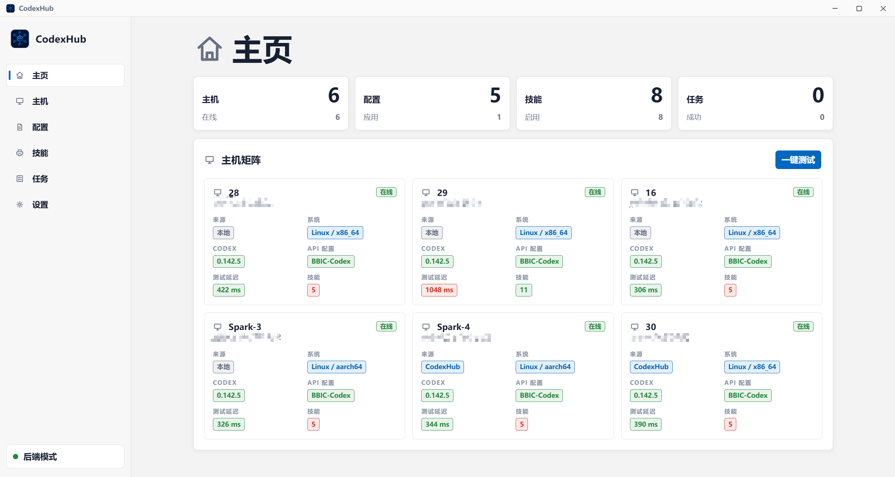 | 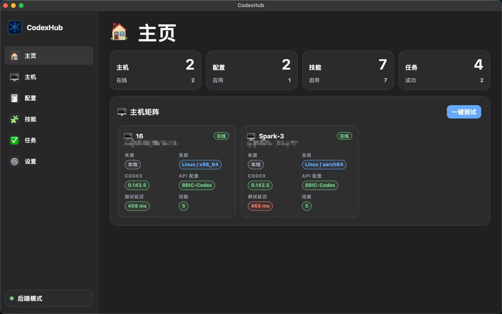 |
| **监控** 查看已记住主机的只读 CPU、内存和 GPU 采样结果，并可展开每个 GPU 用户行查看 PID、进程名、CPU 负载和显存占用。 | 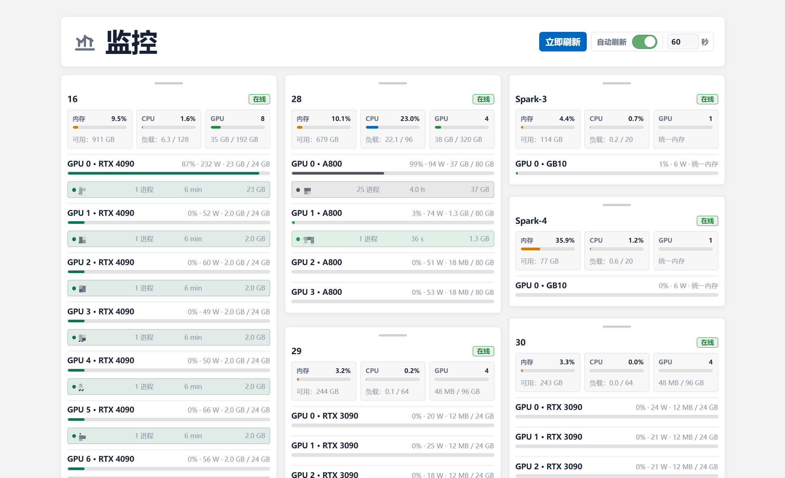 | 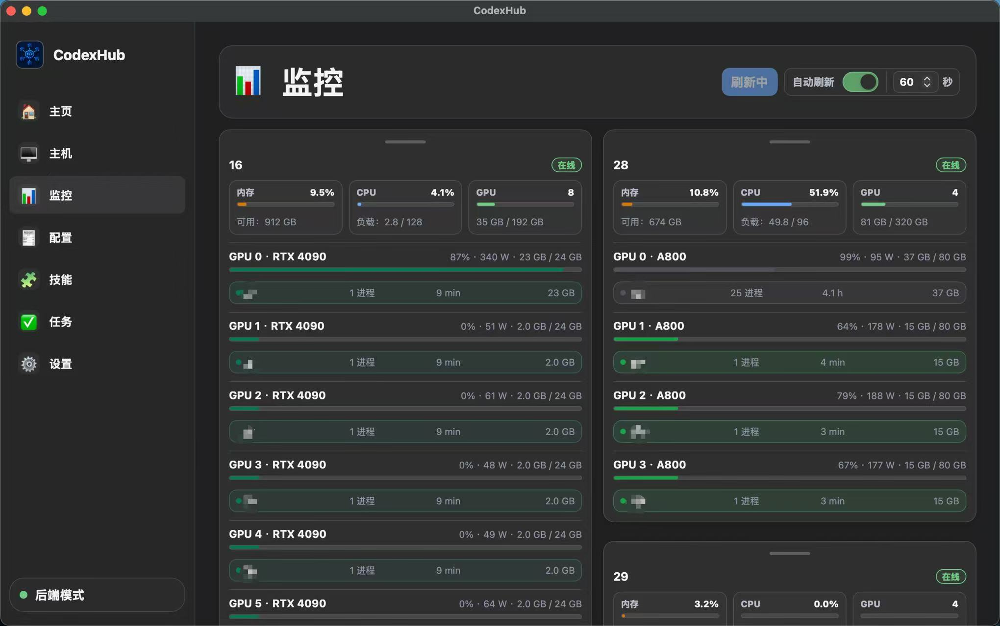 |
| **Hosts** 添加或检查 SSH 主机，完成 key 配置、一次性密码初始化、连接测试和远端 Codex 探测。 | 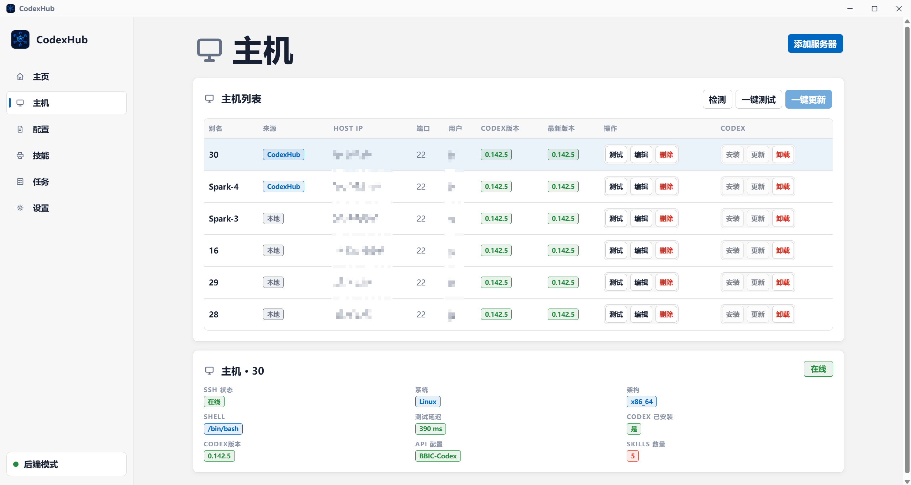 | 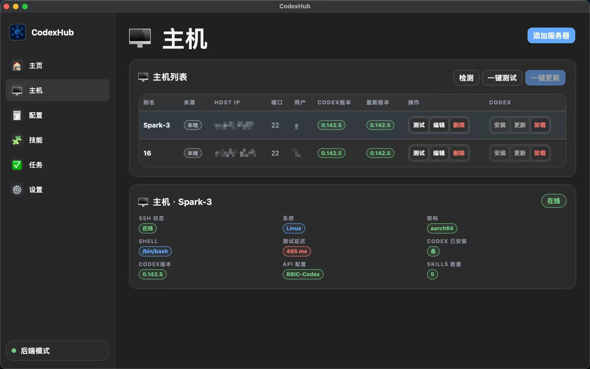 |
| **API 与 Profiles** 管理本地 API config 名称和 profile 模板，再预览或应用远端配置变更。 | 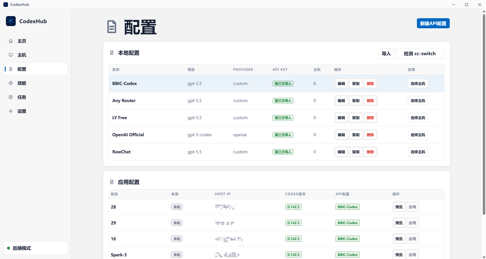 | 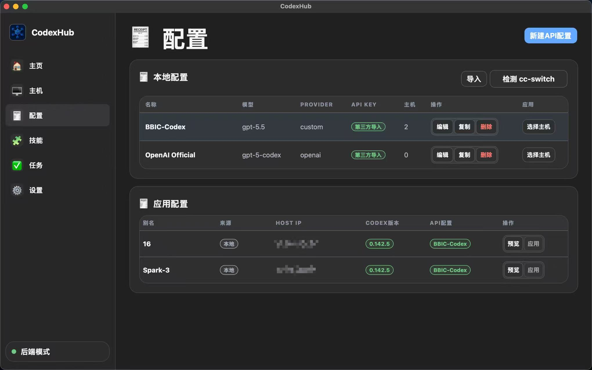 |
| **Skills** 导入本地或 GitHub skill 包，检查安装目标 inventory，预览已安装 skill 标签，并通过任务日志追踪下载或移除结果。 | 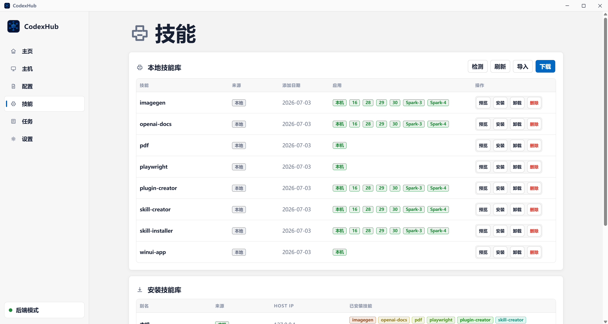 | 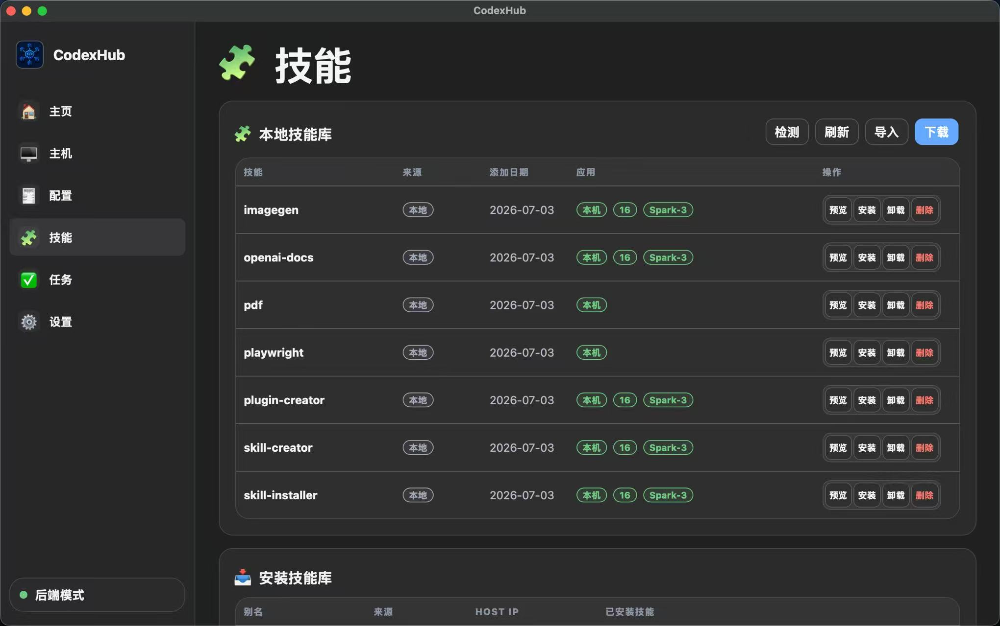 |
| **Settings** 检查本地 SSH 就绪状态、管理应用更新检查，并查看平台相关运行偏好。 | 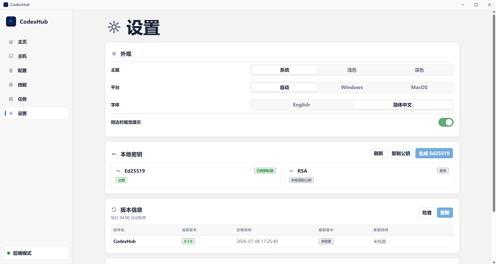 | 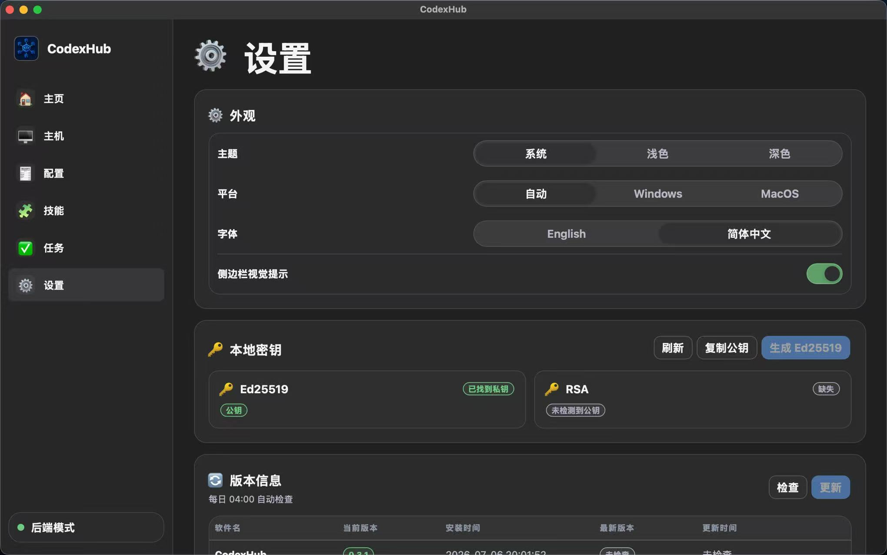 |

## ✨ 核心能力

- 检测 Windows、macOS 和 Linux 的本地 OpenSSH、本地公钥和 SSH config 状态。
- 在没有合适密钥时生成不覆盖旧文件的 Ed25519 key。
- 只读导入本地 SSH config 中安全的 Host alias（Windows 为 `%USERPROFILE%\.ssh\config`，macOS/Linux 为 `~/.ssh/config`）。
- 只写入 CodexHub 托管的 SSH config block，并在写入前备份。
- 通过 `ssh <HostAlias> echo ok` 测试连接。
- 探测远端 Linux 主机的系统、架构、shell、PATH、Codex CLI、`~/.codex/config.toml` 和 skills 数量。
- 在远端用户目录安装或更新 `codex` 命令；应用 profile 时可安装同名托管启动器，用来加载受管 env 后再执行真实 Codex。
- 创建、预览、应用 profile 到远端 `~/.codex/config.toml`。
- Profile 应用确认后，可重载当前 SSH 用户下身份已严格确认的远端 Codex 进程；推荐模式会保留交互式 CLI 和 exec 会话。
- 导入本地或 GitHub skill，并安装到本机或远端目标。
- 对已记住主机展示内存、存储、CPU 和 GPU 两行资源卡片，统一显示占用率；存储汇总已挂载本地磁盘的可用量与总量，并支持展开用户级 GPU 进程详情。
- 提供本地和 SSH 多标签终端，支持重连、resize、搜索、scrollback、读屏模式和大段粘贴确认。
- 浏览本地与远端 SFTP 文件，支持分页、搜索、预览、创建、重命名/复制和可恢复的破坏性操作。
- 传输队列支持上传、下载、暂停、重试、取消、冲突处理、恢复卡片以及重启后的显式重新授权。
- Terminal 与 Files 可并排分屏，并在同一主机下联动规范工作目录。
- 最近 100 条任务记录会跨重启持久保存；每条保留任务的完整诊断信息统一放在“任务”页面，命令与 stdout/stderr 默认脱敏。
- 弹窗支持键盘焦点锁定、Esc 关闭、关闭后焦点恢复、范围明确的状态播报和 reduced-motion。
- 提供 Windows 托盘 / macOS 菜单栏 / Linux 托盘状态图标；首次点击窗口关闭按钮时会询问以后是退出程序还是最小化到托盘，后续可在 Settings 修改。
- 完成准备后，引导用户到 Codex App 手动添加或启用已验证的 SSH alias。

## 🔐 安全边界

- SSH 配置和密钥状态流程只读取、返回和复制公钥，不打开或显示私钥内容；app 明文数据文件不保存 SSH 私钥、passphrase、一次性密码或 OpenAI API key。
- Workspace Files 是用户主动操作的本地文件工具，可以浏览、预览、复制和传输当前系统用户有权访问的文件，也包括用户明确选择的敏感文件。
- 一次性密码和已存储 API key 仅在用户主动点击后临时显示，便于核对或复制；不会写入浏览器存储或 task log。
- 对 SSH 管理流程中的 key 材料，UI 只返回和复制 public key。
- 不修改非 CodexHub 托管的 SSH config 内容。
- 托管 Host block 使用 `# >>> CodexHub managed host: <alias>` 和 `# <<< CodexHub managed host: <alias>` 标记。
- 不写 Codex App 私有文件、数据库、socket、缓存或未公开 IPC。
- 远端进程重载只通过 SSH、Linux `/proc` 身份核验和 `SIGTERM` 完成，不使用宽泛的 `pkill`/`killall` 匹配，也不控制本地 ChatGPT/Codex App 进程。
- Install/Profile 清理仍只处理带有严格托管标记的旧运行时；已验证的 Update 可把严格低版本移入保留的备份目录。current、target、正在使用、发生变化或身份含糊的 Codex 对象都会保留。
- 远端 Codex 配置使用 `env_key` / `apiKeyEnvVar` 引用远端环境变量。
- 显式应用带有已保存 key 的 profile 时，CodexHub 只把真实 key 写入选中远端的 `~/.codex-hub/env`，不会写入远端 config、metadata 或 task log。

更多说明见：[安全策略](../../SECURITY.md)、[已知限制](../known-limitations.md)。

## ✅ 运行要求

Windows 桌面应用需要：

1. Windows 10/11。
2. Microsoft WebView2 Runtime。
3. Windows OpenSSH client：`ssh.exe`、`scp.exe`、`ssh-keygen.exe`。
4. 可通过 SSH 登录的 Linux 远端主机。

macOS 桌面应用需要：

1. Apple Silicon Mac；后续新的本地 `.app` / `.dmg` 构建请用真实 Mac 验证。
2. OpenSSH client tools 和 `ssh-keygen`。
3. 通过 OpenAI/Codex 官方指引安装 Codex CLI。
4. 可通过 SSH 登录的 Linux 远端主机。

Linux 桌面应用需要：

1. Ubuntu/Debian x86_64 或 arm64。
2. OpenSSH client tools 和 `ssh-keygen`。
3. 通过 OpenAI/Codex 官方指引安装 Codex CLI。
4. 可通过 SSH 登录的 Linux 远端主机。

## 🚀 安装

日常使用建议从本仓库的 Releases 页面下载最新 stable 构建。

- Windows：下载并运行 `CodexHub_0.5.4_x64-setup.exe`。
- macOS Apple Silicon：下载 `CodexHub_0.5.4_aarch64.dmg`，打开后将 `CodexHub.app` 移入 Applications。v0.5.4 macOS 资产仍为 unsigned/ad-hoc；首次打开时可能需要通过 Control-click > Open 或 Privacy & Security 手动允许。只信任从本仓库 Release 页面下载的文件。
- `.app.tar.gz` 资产用于应用内更新；macOS 用户日常安装请使用 `.dmg`，不要手动解压 updater archive。
- Linux Ubuntu/Debian x86_64：安装 `CodexHub_0.5.4_amd64.deb`。Linux 默认使用 macOS 风格界面，可在 Settings 切换；已验证的 Linux stable 构建会进入签名自动更新 feed。
- Linux Ubuntu/Debian arm64：安装 `CodexHub_0.5.4_arm64.deb`。已验证的 Linux stable 构建会进入签名自动更新 feed。
- 如果 Settings 中检查更新失败，CodexHub 会弹出日志窗口，并把本次运行记录到 Tasks，方便后续回看。

## ⚡ 快速开始

1. 打开 CodexHub。
2. 在 Settings 检查 Local SSH。
3. 没有 key 时生成 Ed25519 key；已有 key 时不要覆盖。
4. 添加 SSH host，填写 host、user、port 和 identity file。
5. 对尚未配置公钥登录的远端，使用一次性密码引导。
6. 测试 SSH alias，并探测远端主机。
7. 在 Terminal 选择已验证 alias，再打开 Files 或 Split，在同一主机与目录上下文中工作。
8. 上传或下载文件，在 Transfers 查看冲突、暂停/重试/取消与恢复状态。
9. 安装或更新远端 Codex CLI。
10. 创建 profile，先 preview，再 apply。
11. 导入 skill，并安装到本机或远端。
12. 打开 Tasks 查看脱敏日志。
13. 到 Codex App `Settings > Codex > Connections` 添加或启用该 SSH alias。

## 📘 使用流程

### 添加主机

- 使用 Hosts > Add Server 创建新的 CodexHub 托管 alias。
- 现有 alias 可以从本地 SSH config 只读导入，不会重写非托管 block。
- 新托管主机只有在密码登录、公钥安装、权限修复和 key 登录验证成功后才写入。
- 首次 host key 使用 OpenSSH `StrictHostKeyChecking=accept-new`；host key 改变时仍会失败。

### 安装或更新 Codex

- 通过 Profiles 或 Dashboard 操作执行 `check-version`、`install` 或 `update`。
- 远端命令保持为 `codex`；应用 profile 时可安装 CodexHub 托管的 `~/.local/bin/codex` 启动器，先加载 `~/.codex-hub/env`，再执行真实 Codex。
- 安装目标为 `$HOME/.local/bin` 和 `$HOME/.codex`。
- PATH 修复会检查 `.bashrc` 或 `.zshrc`、`.profile`，以及已存在的 `.bash_profile` / `.zprofile`，并写入幂等的 CodexHub 托管 block。
- 单主机和批量 Update 都会先检查引用托管 standalone release 的当前用户进程。CodexHub 会在不返回原始 argv 的前提下区分 Codex App 后台服务、SSH 代理和 CLI/会话，再要求明确确认。用户批准某台主机后，CodexHub 会复核精确身份，先发送 `SIGTERM`，再对顽固进程或停止窗口内安全分类的重启进程发送精确 PID `SIGKILL`，直至连续两次扫描为空。无法分类、未选择、其他用户、批准 release 之外或无法复核的进程仍会使更新在 PATH 修复和安装前失败。
- 本机存在符合条件的 loopback proxy 时，每台并发主机会建立独立的临时 SSH reverse tunnel 并优先经该代理运行官方 installer；隧道或网络失败后依次回退直连、mirror 和本地上传，且不在远端持久化代理配置。
- 安装或更新方式成功后，对于身份已验证的 standalone runtime，CodexHub 会让托管 target 跟随 `~/.codex/packages/standalone/current` 选出的规范可执行文件：本地及当前官方 package release 使用 `bin/codex`，并允许官方 package 精确的 `codex -> bin/codex` 兼容链接；旧版官方布局仍可使用 `codex`。随后验证 target、托管启动器和登录 Shell 中的 `codex` 版本一致。每个写阶段都会获取绑定当前 UID、PID 和 starttime 的锁，入锁后重新读取运行时，并拒绝低于最高已验证版本下限的候选或写后状态。
- 最终验证通过后，Install 和 Profile 应用仍只清理已有严格 marker 的旧托管版本；Update 会进一步接管所有可严格确认、版本低于新版本的 `releases/<entry>` 直接子目录，并把合格 release、启动器 capture 及已知残留 launcher/helper 链接移入 `~/.codex-hub/deletion-backups/update-<UTC>-<PID>/`。官方精确的 `codex -> bin/codex` 兼容链接按同一个规范 package 布局处理；两个独立可执行文件或非规范链接仍视为歧义。任务结果会报告安全的备份 ID；备份保留供人工检查，明确删除备份前不会释放占用空间。current/target、同版本或更高版本、非法 marker、竞态、正在使用及身份不明目录都会保留。所有清理均共用运行时锁、复核进程身份、要求同文件系统的禁止覆盖移动，并且不会覆盖已有备份。仅这个可恢复的 Update 分阶段备份流程允许忽略 `/proc/<pid>/exe` 不可读、但经双次稳定核验的当前用户 `sshd`、`(sd-pam)`、`sftp-server`、`fusermount3` 会话辅助进程；完整命令行严格为 `/usr/lib/systemd/systemd --user` 或 `/lib/systemd/systemd --user` 且无额外参数的用户管理器；以及 state=`Z`、cmdline 为空、`Threads: 1` 且仅含 leader TID 的僵尸进程。每次候选复核都必须与 PID/starttime/state/comm/完整 cmdline 初始快照一致，僵尸还要重复证明单线程，任务摘要会记录忽略数量。Install/Profile 仍保持严格，新出现、身份变化、未知、多线程僵尸或疑似 Codex 的进程仍会使清理延期。

### 使用 Workspace Terminal、Files、Split 与 Transfers

- Terminal 以标签页打开本地 Shell 或已有 SSH alias；断线状态会保留并支持重连，同时提供 resize、搜索、scrollback、读屏模式和大段粘贴确认。
- Files 访问本机或所选主机的 SFTP 文件。分页与搜索是显式操作；预览、创建、重命名、复制、覆盖和删除遵循当前目录与确认规则。
- 删除、覆盖和重命名产生的恢复记录可在 Files 或 Transfers 中还原；永久 purge 仍是单独确认操作。
- Transfers 展示上传/下载进度、暂停、重试、取消和冲突选择。应用重启后，受影响的本地文件授权必须由用户重新确认，队列才会继续。
- Split 并排显示 Terminal 与 Files；后端返回规范路径时，可以让文件浏览器跟随当前终端工作目录。

### 应用 Profile

- Profiles 渲染为 TOML。
- API key 使用环境变量引用；如果 profile 已保存本地 key，应用时会把真实值写入选中远端的 `~/.codex-hub/env` 并设置受限权限。
- 应用前先预览。
- 如果远端 config 已一致，CodexHub 报告 no changes，不创建备份。
- 如果文件发生变化，CodexHub 创建时间戳备份，并在 Tasks 中记录结果。
- 运行时协调会防止 Profile 应用恢复旧 standalone 版本：托管 target 继续跟随 `standalone/current`，低版本运行时会被拒绝。
- 每次应用都会确认重载方式：仅重载远端 Codex App 服务（推荐）、只应用配置或终止全部已确认的远端 Codex 会话；终止全部会话需要额外勾选确认。
- 如果 15 秒内未观察到新的 App 服务，已落盘配置仍保持生效；请到本地 ChatGPT/Codex App 的 `Settings > Codex > Connections` 手动重连。
- 远端重载只属于 profile 应用流程，不提供独立的 Host 重载按钮，也不使用本地 App 的私有数据库、socket 或 IPC。

### 安装 Skills

- 可以导入包含 `SKILL.md` 的本地目录，也可以导入 GitHub 仓库/子目录 URL。
- CodexHub 会在 app config 目录保存一份托管本地副本。
- 目标检测使用缓存 inventory；给新主机安装前请先运行检测。
- 已安装 skill 标签可打开预览。下载会把该已安装目录导入本地技能库；卸载需要二次确认，并会永久删除当前目标上的该 skill 目录。
